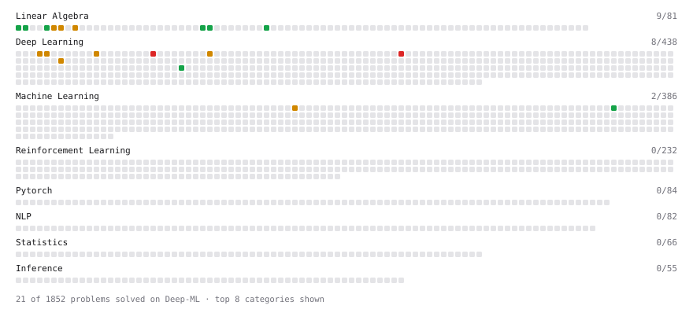

# Deep-ML

My machine learning practice from [Deep-ML](https://www.deep-ml.com). Every solution here was written by hand.

**23** solved · 21 problems · 0 labs · 2 math

[**Browse the interactive portfolio**](https://MAXNORM8650.github.io/deep-ml/) to replay this filling in over time.

## Problems

| | Difficulty | Solved | |
| --- | --- | --- | --- |
| [Calculate Cosine Similarity Between Vectors](https://www.deep-ml.com/problems/76) | easy | 2026-10-18 | [solution](problems/0076-calculate-cosine-similarity-between-vectors) |
| [Derivative of a Polynomial](https://www.deep-ml.com/problems/116) | easy | 2026-10-18 | [solution](problems/0116-derivative-of-a-polynomial) |
| [Dot Product Calculator](https://www.deep-ml.com/problems/83) | easy | 2026-10-18 | [solution](problems/0083-dot-product-calculator) |
| [Gradient Direction and Magnitude](https://www.deep-ml.com/problems/308) | easy | 2026-10-18 | [solution](problems/0308-gradient-direction-and-magnitude) |
| [Matrix-Vector Dot Product](https://www.deep-ml.com/problems/1) | easy | 2026-10-18 | [solution](problems/0001-matrix-vector-dot-product) |
| [Scalar Multiplication of a Matrix](https://www.deep-ml.com/problems/5) | easy | 2026-10-18 | [solution](problems/0005-scalar-multiplication-of-a-matrix) |
| [Simple Self-Attention Without Trainable Weights](https://www.deep-ml.com/problems/955) | easy | 2026-10-24 | [solution](problems/0955-simple-self-attention-without-trainable-weights) |
| [Transpose of a Matrix](https://www.deep-ml.com/problems/2) | easy | 2026-10-18 | [solution](problems/0002-transpose-of-a-matrix) |
| [Vector Norms (L1/L2/L-inf) and the Frobenius Norm](https://www.deep-ml.com/problems/328) | easy | 2026-10-18 | [solution](problems/0328-vector-norms-l1-l2-l-inf-and-the-frobenius-norm) |
| [Calculate Eigenvalues of a Matrix](https://www.deep-ml.com/problems/6) | medium | 2026-10-20 | [solution](problems/0006-calculate-eigenvalues-of-a-matrix) |
| [Implement Efficient Sparse Window Attention](https://www.deep-ml.com/problems/131) | medium | 2026-10-29 | [solution](problems/0131-implement-efficient-sparse-window-attention) |
| [Implement Masked Self-Attention](https://www.deep-ml.com/problems/107) | medium | 2026-10-28 | [solution](problems/0107-implement-masked-self-attention) |
| [Implement Self-Attention Mechanism](https://www.deep-ml.com/problems/53) | medium | 2026-10-28 | [solution](problems/0053-implement-self-attention-mechanism) |
| [Implementing Basic Autograd Operations](https://www.deep-ml.com/problems/26) | medium | 2026-10-24 | [solution](problems/0026-implementing-basic-autograd-operations) |
| [KV Cache for Efficient Autoregressive Attention](https://www.deep-ml.com/problems/376) | medium | 2026-10-30 | [solution](problems/0376-kv-cache-for-efficient-autoregressive-attention) |
| [Matrix times Matrix ](https://www.deep-ml.com/problems/9) | medium | 2026-10-18 | [solution](problems/0009-matrix-times-matrix) |
| [Matrix Transformation ](https://www.deep-ml.com/problems/7) | medium | 2026-10-20 | [solution](problems/0007-matrix-transformation) |
| [Quotient Rule for Derivatives](https://www.deep-ml.com/problems/312) | medium | 2026-10-18 | [solution](problems/0312-quotient-rule-for-derivatives) |
| [Single Neuron with Backpropagation](https://www.deep-ml.com/problems/25) | medium | 2026-10-20 | [solution](problems/0025-single-neuron-with-backpropagation) |
| [Flash Attention v1 - Forward Pass](https://www.deep-ml.com/problems/208) | hard | 2026-10-29 | [solution](problems/0208-flash-attention-v1-forward-pass) |
| [Implement Multi-Head Attention](https://www.deep-ml.com/problems/94) | hard | 2026-10-28 | [solution](problems/0094-implement-multi-head-attention) |

## Math

| | Difficulty | Solved | |
| --- | --- | --- | --- |
| [Derivatives and Gradients](https://www.deep-ml.com/math-problems/1) | easy | 2026-10-18 | [solution](math/0001-derivatives-and-gradients) |
| [Gradient Descent Updates](https://www.deep-ml.com/math-problems/5) | easy | 2026-10-18 | [solution](math/0005-gradient-descent-updates) |

---

_This file is regenerated by Deep-ML on every push._
